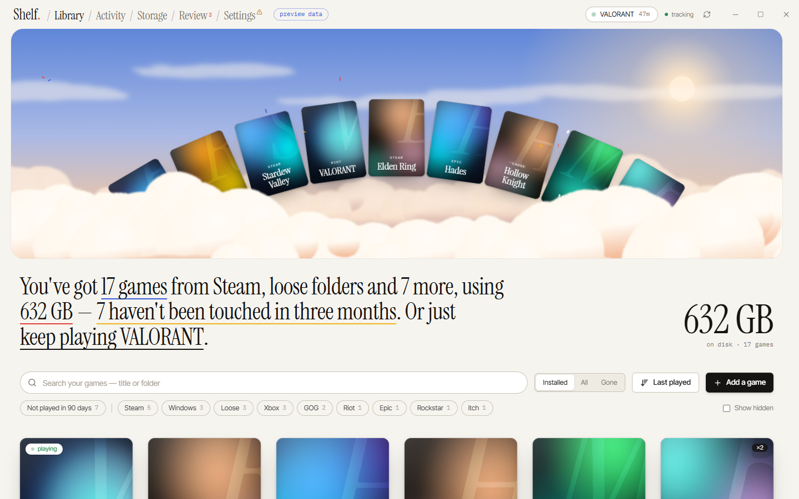
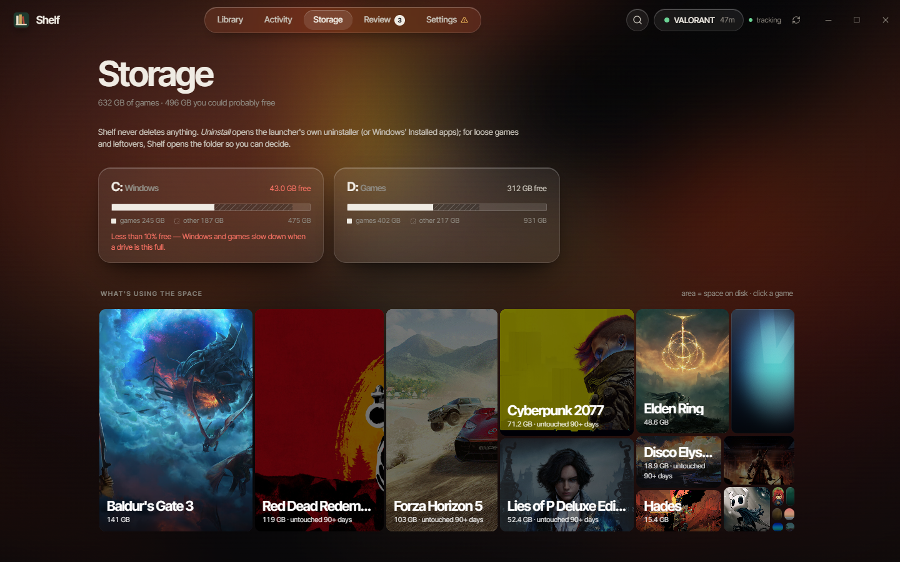
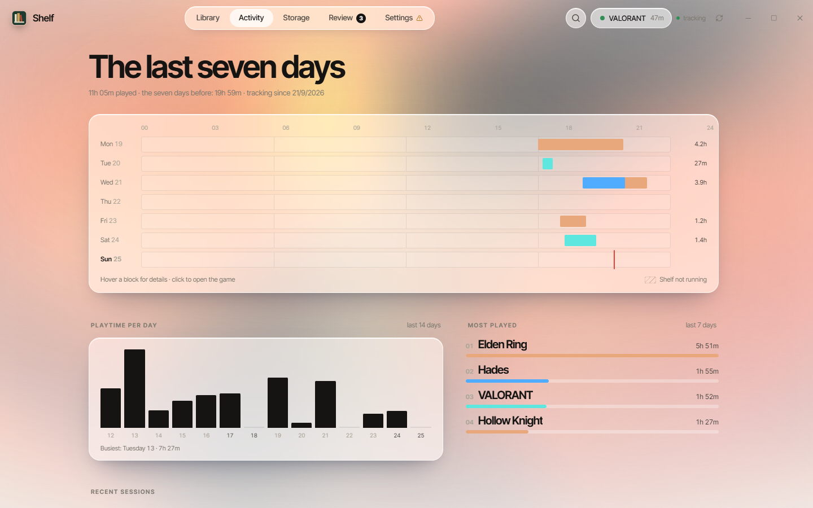
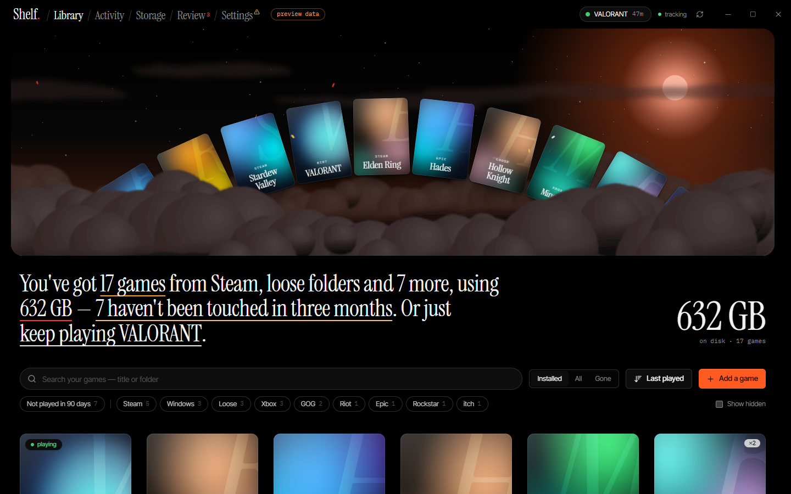

# Shelf

**Every game on your Windows PC, in one place — even the ones you forgot.** Shelf finds what Steam, Epic, Xbox and
nine other launchers installed, *and* the games you downloaded as a zip and unpacked into some folder. It keeps track
of what you play, and shows you what's quietly filling up your drives.

**Website: [shelf-anish.vercel.app](https://shelf-anish.vercel.app)** · **[Download for Windows](https://github.com/Anish-Juyal-01/Shelf/releases/latest)**



- **Every launcher**: Steam, Epic Games, GOG Galaxy, EA app, Ubisoft Connect, Rockstar, Battle.net, Riot, Xbox app
  (Microsoft Store / Game Pass), itch, Amazon Games and HoYoPlay — read straight from their files on disk. No sign-ins.
- **Loose games too**: Shelf walks the folders you choose (it suggests some, or scans a whole drive when you ask) and
  recognises games by their engine files and real executables. Every folder gets a score out of 100: **70+** goes
  straight into your library, **35–69** waits in **Review** for a yes or no.
- **New downloads show up on their own**: unzip a game into a watched folder and it appears about a minute after the
  folder goes quiet.
- **Playtime tracking** for every game, from any launcher or a desktop shortcut. Steam's own hours are imported on
  day one. Sleep, crashes and restarts are handled, and time when Shelf wasn't running is shown as a gap — never guessed.
- **Spots unknown games**: a program Shelf doesn't know that runs fullscreen or keeps the GPU busy for a minute gets a
  "Looks like you're playing X — add it?"
- **Storage view**: every game drawn to the size it takes, games untouched for 90+ days, second copies of the same
  game, and leftover installers and archives. **Shelf never deletes anything** — *Uninstall* opens the launcher's own
  uninstaller (or Windows' Installed apps); for loose games it opens the folder so you decide.
- **Art**: covers, backgrounds, logos and each game's own icon, taken from what your launchers already keep on disk —
  and, if you allow it, looked up online for whatever's missing (see [Data & privacy](#data--privacy)).
- **Twelve colour themes** — six colourful, six black — each with a day and a night version (or follow Windows), and
  two ways to show your library: a wheel or a ring.
- Tray icon, Start with Windows, single instance, Windows notifications for new games.
- Light on the PC: a small native app (Rust + Tauri) whose watcher checks running programs every 5 seconds and uses
  well under 1% CPU.

| Storage | Activity | Black theme (Ember) |
|---|---|---|
|  |  |  |

*Screenshots use Shelf's built-in sample library.*

## Install

**Download**: get the installer from [Releases](https://github.com/Anish-Juyal-01/Shelf/releases/latest) and run it.
It installs for your user only (no admin rights) into `%LOCALAPPDATA%\Programs\Shelf`, with a Start menu entry.
Shelf needs Microsoft Edge WebView2, which is already on Windows 11 and almost every up-to-date Windows 10 PC; the
installer fetches it if it's missing.

**Or build it yourself** — you need Windows 10 (1809+) or 11, 64-bit; [Rust](https://rustup.rs) (stable, MSVC) with the
Visual Studio C++ build tools; and [Node.js](https://nodejs.org) 20 or newer.

```powershell
git clone https://github.com/Anish-Juyal-01/Shelf.git
cd Shelf
powershell -ExecutionPolicy Bypass -File scripts/build.ps1     # runs the tests, builds the app + installer into dist\
powershell -ExecutionPolicy Bypass -File scripts/install.ps1   # installs it for you (or run dist\Shelf_*-setup.exe)
```

Then type **Shelf** in Windows search. Installing over an older Shelf (including the first, .NET-based builds) keeps
your library, playtime and settings.

**First run**: Shelf reads every launcher straight away. Then:

1. **Settings → Scan folders**: add the folders where you keep downloaded games (Shelf suggests likely ones), or
   scan a whole drive once.
2. **Settings → Start with Windows**: so play time is counted even when you never open the window. Closing the window
   keeps Shelf in the tray (bottom right, near the clock); right-click the tray icon to quit.
3. **Settings → Art** (optional): paste a free [SteamGridDB](https://www.steamgriddb.com) API key (sign in, then
   your profile → **Preferences → API → Generate**) for icons and art of games that aren't on Steam.

**Uninstalling**: Windows' *Installed apps*, or `scripts/install.ps1 -Uninstall`. This removes the program, the Start
menu shortcut and the start-with-Windows task. Your library stays in `%APPDATA%\Shelf` — delete that and
`%LOCALAPPDATA%\Shelf` too if you want everything gone.

## Build from source

```
core/        shelf-core — the engine: launcher readers, scanner, matcher, storage, watcher (no UI)
cli/         shelf-cli — the engine from the command line
src-tauri/   the app: window, bridge to the UI, tray, startup (Tauri 2)
ui/          the React UI (and the website)
```

```powershell
./scripts/build.ps1                          # full pipeline: tests + release build + installer → dist\
npx --prefix ui tauri dev                    # day-to-day: the app with a live-reloading UI
cd ui; npm install; npm run dev              # the UI alone, with sample data, at http://localhost:5174
```

Opening the UI in a normal browser shows a **sample library** (with a *preview data* badge) — it's only for design work
and is never used inside the app. `SHELF_DATA_DIR=<folder>` makes the app or CLI use a separate data folder, handy for
trying things without touching your real library.

### Tests

```powershell
cargo test                              # launcher readers, folder classifier, scanner, name cleaner, tracking, storage, web art
cd ui; npm test                         # themes, headline, treemap, library filters
```

### Command line

`shelf-cli` (in `dist\`, and installed next to `Shelf.exe`) uses the same engine as the app:

```powershell
shelf-cli sources                  # what each launcher reader found, and any problems
shelf-cli scan D:\Games            # scan a folder (or a whole drive, e.g. D:\) for games
shelf-cli list --sort size         # every game with size and playtime (--review, --leftovers, --json)
shelf-cli watch                    # track playtime live (Ctrl+C to stop)
shelf-cli sessions --days 7        # play sessions
shelf-cli review accept <id>       # add a detection from Review (or: reject)
shelf-cli add <exe> [title]        # add a game by its exe
shelf-cli art [--key K] [--again]  # look up missing art online
shelf-cli clean "Hollow_Knight_v1.5 [FitGirl Repack]"   # → Hollow Knight
```

### Website

The project's one-page website lives in the same UI project:

```powershell
cd ui; npm run dev:site      # http://localhost:5175
cd ui; npm run build:site    # static files in ui\dist-site (deployed to Vercel from ui/, see ui/vercel.json)
```

## How detection works

| Where the game came from | How Shelf finds it |
|---|---|
| Steam | `libraryfolders.vdf` and each library's `appmanifest_*.acf`; playtime from `localconfig.vdf` |
| Epic Games | the launcher's `.item` manifests |
| GOG, EA, Ubisoft, Rockstar, Battle.net, Riot, HoYoPlay | the launchers' registry entries |
| Xbox app / Game Pass | `.GamingRoot` on each drive and every game's `MicrosoftGame.config` |
| itch, Amazon Games | read-only snapshots of the launchers' own databases |
| Anything else installed | Windows' installed-apps list, checked by the folder classifier |
| Loose folders | the folder classifier: engine fingerprints (Unity, Unreal, Godot, FNA, RPG Maker, Ren'Py…), real executables vs. tools and redistributables, save/data folders |

The same game found twice (a Steam copy and a loose copy, say) becomes one game with ×2, so duplicates are easy to
spot. Scans are incremental and cancellable; a full refresh runs every 30 minutes in the background.

## Data & privacy

Shelf only **reads** launcher files, the registry and game folders — it never changes, moves or deletes anything in
them (a test checks that no code outside Shelf's own storage writes files). Everything it knows stays on this PC:

- `%APPDATA%\Shelf\settings.json` — your settings (and your SteamGridDB key, if you add one)
- `%APPDATA%\Shelf\shelf.db` — your library, play sessions and decisions (SQLite)
- `%LOCALAPPDATA%\Shelf` — caches: art (`art\`) and the scan cache
- `%LOCALAPPDATA%pp.shelf.desktop` — the window's WebView2 data
- Start with Windows: a per-user Task Scheduler task named **Shelf** (no admin rights)

**What goes online**: only art lookups, and only while **Settings → Art → Look up missing art online** is on (it is by
default). For a game without art, Shelf sends its **title** to Steam's store search, and downloads the matching cover,
background and logo from Steam's image server. With a SteamGridDB key, it also asks SteamGridDB (title or Steam app id).
Nothing else — no library, no playtime, no account, no analytics. Each game is looked up at most once a week. Turn the
switch off and Shelf never touches the network.

## Known limitations

- **Not code-signed yet**: Windows SmartScreen may ask before running the installer (*More info → Run anyway*).
- **Loose-folder detection is a judgement call**: odd games can land in Review instead of the library, and the
  occasional tool can be suggested. Review and *Not a game* are there for that, and decisions are remembered.
- **Playtime is counted while Shelf runs** (turn on *Start with Windows*). Steam's own hours are imported; other
  launchers don't keep hours Shelf can read.
- **Spotting unknown games** uses Windows' GPU performance counters; on PCs without them only fullscreen programs are
  noticed.
- **Online art only matches the same game by name** (editions and punctuation aside), so a game with an unusual name
  may get no art rather than the wrong art.

See [docs/PLAN.md](docs/PLAN.md) for the design and the reasoning behind it.

## License

MIT — see [LICENSE](LICENSE). Third-party libraries and fonts are listed in [THIRD_PARTY_NOTICES.md](THIRD_PARTY_NOTICES.md).
